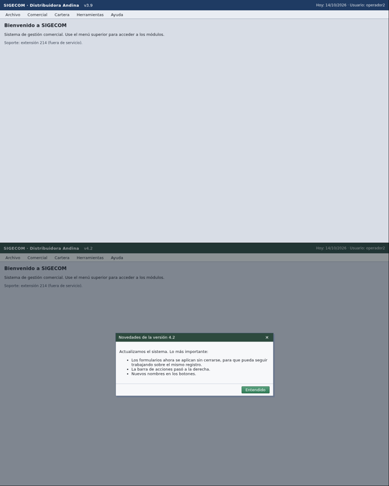
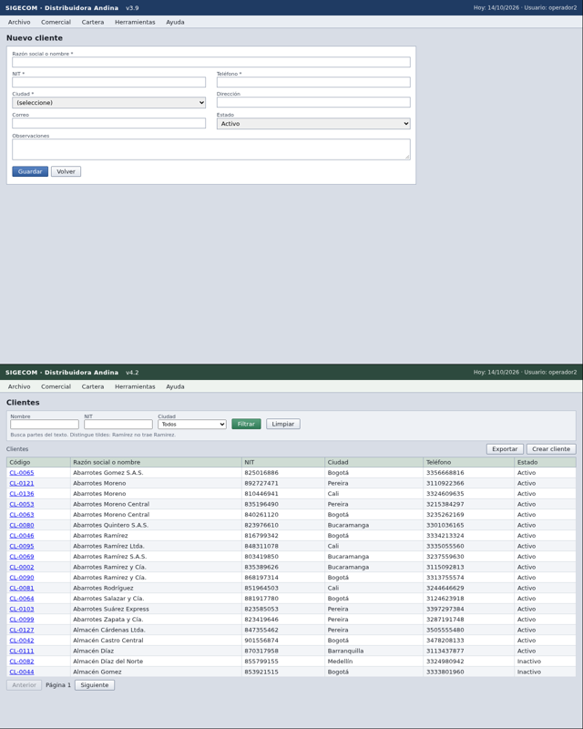

# agente-sin-api

Agente que opera por pantalla (VNC) sistemas de gestión sin API y ejecuta tareas pedidas en
lenguaje natural, incluso en apps que nunca ha visto. Reto 1 de Frontier Bogotá 2026.

Desplegado en `https://agente-sin-api-production.up.railway.app` (Railway). Set de evaluación oculto,
corrida 1: 25/56. Suite propia sobre la versión mejorada: 19/20 en crear, modificar, consultar y
exportar, sin acciones de más ni falsos éxitos. Detalle en [Evaluación](#evaluación).

## Cómo correrlo

Requisitos: Python 3.12 o más reciente y [uv](https://docs.astral.sh/uv/).

```bash
uv sync                      # instala dependencias (incluye las de desarrollo)
cp .env.example .env         # y llena los valores; .env nunca se sube
uv run python -m pytest tests -q
```

Variables de `.env` (ver `.env.example`):

| Variable | Para qué |
|---|---|
| `OPENROUTER_API_KEY` | Llamadas a los modelos |
| `AGENT_MODEL`, `SUPERVISOR_MODEL` | Operador por paso (`anthropic/claude-haiku-5.5`) y supervisor (`anthropic/claude-sonnet-5.5`) |
| `TEAM_TOKEN` | Token que exige el entrypoint en `Authorization: Bearer` |
| `DESKTOP_URL`, `DESKTOP_PASSWORD`, `DESKTOP_TOKEN` | Escritorio de práctica, solo para los harness locales |
| `MEMORY`, `MEMORY_DB` | Memoria que aprende: apagada salvo `MEMORY=on`; base SQLite |

Servicio local y una tarea de prueba:

```bash
uv run uvicorn service.api:app --port 8000
curl -s localhost:8000/health
curl -s -X POST localhost:8000/tasks -H "Authorization: Bearer $TEAM_TOKEN" \
  -H "Content-Type: application/json" \
  -d '{"tarea": "¿Cuántas facturas vencidas hay?", "escritorio": {"url": "wss://…/websockify", "password": "…"}}'
curl -s localhost:8000/tasks/<task_id> -H "Authorization: Bearer $TEAM_TOKEN"
```

Harness de evaluación (resetea el escritorio, corre el agente y pide `__check`):

```bash
uv run python -m evals.run                    # todos los casos de evals/cases/, en proceso
uv run python -m evals.run E1 --reps 3        # un caso, varias veces
uv run python -m evals.suite                  # suite propia de 34 casos con reporte por categoría y puerta de deploy
uv run python -m evals.suite --categoria consultar   # una categoría
uv run python -m evals.traces --desde 17:56   # en qué gastó el tiempo el agente en producción, tarea por tarea
uv run python -m evals.targets <URL> E2       # el mismo caso por HTTP contra el entrypoint desplegado
uv run python -m evals.curve --n 4            # curva de aprendizaje: sin memoria y con memoria
uv run python -m evals.canary --cada 20       # canario: avisa si la app cambió
```

Deploy (Railway): el `Dockerfile` construye la imagen y `railway.json` define el chequeo de
`/health`. Se monta un volumen en `/data` para las trazas y la memoria, y se configuran las mismas
variables de `.env` salvo las del escritorio de práctica.

## Contrato del entrypoint

| Ruta | Qué hace |
|---|---|
| `GET /health` | 200 cuando el agente está listo |
| `POST /tasks` | Recibe `{tarea, escritorio: {url, password}}` y responde `{"task_id": "…"}` en menos de 2 s |
| `GET /tasks/{task_id}` | `{"estado": "en_curso" \| "terminada" \| "fallida", "resumen": "…"}` |

Todas las llamadas llevan `Authorization: Bearer <TEAM_TOKEN>`.

## Arquitectura


Principio: **el modelo percibe y decide; el código garantiza.** El agente no tiene DOM ni API: ve
capturas por VNC y actúa con mouse y teclado.

| Pieza | Archivo | Qué hace | Modelo |
|---|---|---|---|
| Servicio | `service/` | Contrato HTTP, una tarea asyncio por pedido, reloj de 270 s, filtro de secretos | Ninguno |
| Comprensión | `agent/comprension.py` | Convierte la instrucción en un `TaskSpec`: tipo, entidad, referente, valores literales, riesgos | Sonnet 5.5 |
| Operador | `agent/operador.py` | Observa, decide y actúa paso a paso con herramientas (clic, rellenar, leer lista, contar, terminar) | Haiku 5.5 |
| Driver | `agent/rfb.py`, `agent/escritorio.py` | Cliente VNC propio: clic sostenido 180 ms (bajo 100 ms la app lo ignora), teclas a 80 ms (tildes), lectura exacta por portapapeles | Ninguno |
| Compuertas | `agent/operador.py` | Toda acción que puede cambiar datos pasa por revisión; se guarda una sola vez | Sonnet 5.5 |
| Verificación | `agent/operador.py` | Contexto limpio: relee la app y decide `terminada` o `fallida` | Sonnet 5.5 |
| Recuperación | `agent/recuperacion.py` | Diario de campos editados, diagnóstico de la falla y restauración del valor anterior exacto | Reglas, y Sonnet solo si son ambiguas |
| Reporte | `agent/reporte.py` | Plantilla, línea `respuesta:` por código, sin secretos | Ninguno |
| Memoria | `agent/memory/` | Huella de la app, recetas verificadas con anclas visuales, lecciones del verificador | Ninguno |

Detalle y alternativas descartadas en [docs/DISENO.md](docs/DISENO.md).

### Memoria que aprende

Aprende solo de tareas que la verificación confirmó (y, en desarrollo, que pasaron `__check`).

- **Huella:** miniatura en color de la primera pantalla y de la barra superior. Tras un reset, la
  pantalla inicial de la misma app es idéntica al píxel; otra página difiere ~25%.
- **Recetas:** de una traza verificada se guarda solo lo que no cambia datos: navegación y campos que
  salen del `TaskSpec`. Se corta antes de cualquier clic que pueda guardar y antes de editar un
  registro existente. Al repetirla, cada clic exige que el recorte de 48×48 px alrededor del punto
  siga en pantalla (±3 px; dos menús vecinos difieren 9,5% y el umbral es 3%). Si no coincide, se
  detiene y el operador sigue desde ahí.
- **Lecciones:** lo que la verificación exigió antes de aceptar una tarea de ese tipo, y los pasos
  donde una receta dejó de coincidir. Van en el prompt del operador.
- **Encendida en producción desde las 14:40** (`MEMORY=on`), después de que la curva mostró mejora. `/health` dice si está activa.

## Evaluación

### Set de evaluación oculto (la app que el agente no conoce)

La plataforma muestra solo números por categoría, nunca los casos.

| Corrida | Versión | Completadas | Fáciles | Regulares | Difíciles | Mediana por caso |
|---|---|---|---|---|---|---|
| 1 (15:28-17:17) | `da361d7` | **25/56** | 15/17 | 10/23 | 0/16 | 1 min 34 s |

Por qué fallan en la corrida 1, según la plataforma (una tarea puede fallar en varios chequeos):
estado reportado 28, cambios esperados 23, respuesta o razón 5, acciones fuera de la tarea 1.

Lectura, tarea por tarea con las trazas: la causa principal no es la velocidad (mediana de 1 min 34 s
sobre 5 min) sino que el agente se rinde. Cierra `fallida`, el verificador le dice qué faltó, y el
operador vuelve a cerrar `fallida` sin hacerlo; el ciclo lo aceptaba a la segunda objeción. Eso explica
que estado y cambios esperados fallen juntos. La seguridad sí aguantó: una sola acción de más en 56
tareas.

### Suite propia

Cinco casos de práctica son pocos para iterar. La suite (`evals/suite.py`) suma 26 casos propios a los
del enunciado: cada valor esperado se leyó en la app 4.2 y el formato de cada tipo de cambio se validó
haciéndolo a mano y pidiendo `__check`. Cubre lo que tumbó la corrida 1: tareas que el agente abandona,
botones con diálogo de confirmación, formularios que no se cierran al aplicar, homónimos, clientes que
no existen, fechas relativas ("ayer", "el sábado"), conteos de varias páginas, dos datos en una
respuesta y secretos en pantalla. El reporte dice si un candidato pasa la puerta para desplegar: ningún
falso éxito ni acción de más, ninguna tarea por encima de 240 s y costo medio de US$0,07 o menos (las 56
tareas del debrief tienen que caber en la reserva de US$5).

| Versión | Crear | Modificar | Consultar | Exportar | Costo por tarea | Máximo |
|---|---|---|---|---|---|---|
| `5fa8998` (candidato, 17:11-17:42) | 4/4 | 5/5 | 7/8 | 3/3 | US$0,044 | 220 s |

La falla (S09, "el pedido que se registró el sábado"): el agente encontró la respuesta correcta a los
112 s y el verificador la objetó cuatro veces pidiendo pruebas que la app no da, hasta agotar el
tiempo. La versión de producción de ese momento falla el mismo caso por otra causa: toma el viernes
como sábado. En los casos de riesgo (imposibles y peligrosas), el candidato hizo un cambio en una tarea
con dos clientes del mismo nombre; esa regla se retiró antes de desplegar.

Harness propio: `__reset` → agente → `__check` de la app + chequeos locales (estado, línea
`respuesta:`, datos clave de la razón, sin secretos). Casos en `evals/cases/` (E1-E5 del enunciado y
J1, una ciudad que no existe en la lista cerrada).

| Hora | Versión | Resultado | Costo total | Tiempo medio |
|---|---|---|---|---|
| 13:04 | línea base | 4/5 | US$0,19 | 85 s |
| 13:15 | `ca6d5f5` (compuerta por nombre del control) | 5/5 | US$0,115 | 55 s |
| 13:38 | `46c27c0` (guarda de borde) | 5/5, y E1 3/3 | US$0,115 | 56 s |

Curva de aprendizaje (`evals/curve.py`): cuatro tareas de crear con datos y redacción distintos, cada
una con `__reset` y `__check`. Sin memoria, y con una memoria nueva que aprende de la tarea 1.

| Corrida | Modo (tareas 2-4) | Pasan | Llamadas (media) | Costo (media) | Tiempo (media) |
|---|---|---|---|---|---|
| 14:23, main en `4b5f0ac` | Sin memoria | 3/3 | 20,0 | US$0,0269 | 93 s |
| | **Con memoria** | **3/3** | **12,7 (−37%)** | **US$0,0224 (−17%)** | **67 s (−28%)** |
| 13:42, primera versión | Sin memoria | 2/3 | 14,3 | US$0,0319 | 76 s |
| | Con memoria | 2/3 | 13,3 | US$0,0405 | 94 s |

Qué aprendió en la corrida de las 14:23: la receta repite sin modelo la ruta «menú Comercial →
submenú Maestros → opción Clientes» (3 clics, 13 s, anclas verificadas) y las notas le dan al
operador la ruta y dónde está cada campo («NIT» en (239, 180), «nombre» en (463, 136)...). El ahorro
de costo es menor que el de llamadas porque la mayor parte del costo es Sonnet (comprensión,
revisión y verificación), que la memoria no salta a propósito.

La primera versión no mejoró: la receta dejaba una búsqueda escrita sin ejecutar y el verificador
devolvía la tarea. Se corrigió (una búsqueda a medias ya no entra en la receta) y Juanes agregó al
núcleo las etiquetas de cada clic y las objeciones del verificador. Límite: son 3 tareas por modo y
un solo tipo de tarea; la varianza entre corridas es alta (11 a 22 llamadas para la misma tarea).

## Incidente

Protocolo preparado antes de las 15:30:

1. **Detectar sin modelo.** `evals/canary.py` resetea el escritorio de práctica cada 5 minutos (cada 10 desde las 16:13), llega
   con clics fijos a seis pantallas (inicio, menú, lista y formulario de clientes, facturas, pedidos)
   y compara cada una con su base al píxel. Tras un reset, la misma pantalla da 0 píxeles de
   diferencia y un menú renombrado mueve ~230, así que cualquier cambio dispara la alerta (campana,
   notificación, imágenes con las regiones marcadas y línea con hora en `runs/canary/log.jsonl`).
2. **Medir el impacto.** Correr `evals.run` completo y comparar con la línea base de las 15:00.
3. **Adaptarse.** El agente no depende de coordenadas: percibe cada pantalla. La memoria deja de repetir
   una receta en cuanto un ancla no coincide.
4. **Explicar.** Esta sección: hora de detección, síntoma, causa, arreglo y evals antes y después.

### Qué pasó (escritorio de práctica, horas de Bogotá)

| Hora | Señal | Fuente |
|---|---|---|
| 15:48:45 | Última ronda en la versión 3.9: 0 píxeles de diferencia en las seis pantallas | `runs/canary/log.jsonl` |
| 15:52:22 | Alerta del canario: no pudo leer el escritorio (`ConnectionClosedError`). El escritorio se estaba reiniciando con la versión nueva | `runs/canary/salida.log` |
| 15:55:30 | El escritorio de Juanes ya muestra la versión 4.2 | observación directa |
| 15:57:23 | Primeras capturas con cambios (inicio, menú y clientes); la ronda se cayó a las 15:59 antes de terminar | `runs/canary/155723-*` |
| **16:03:14** | **Alerta de cambio: las seis pantallas cambian entre 92% y 99,7% de sus píxeles** | `runs/canary/160314-*-cambios.png` |
| 16:07:17 | Con las sondas cerrando el aviso: cambian las barras de arriba en todas, y la sonda «nuevo cliente» llega a otra pantalla | `runs/canary/160717-*` |
| 16:13 | Bases nuevas de la 4.2 (las de la 3.9 quedan en `runs/canary/v3.9/`); ronda de control a las 16:15 con 0 px | `runs/canary/log.jsonl` |

**Qué cambió en la app (versión 3.9 → 4.2).** Lo dice el propio aviso que la app abre al iniciar y
lo confirman las capturas:

- Un aviso modal «Novedades de la versión 4.2» tapa la pantalla hasta pulsar «Entendido».
- **Los formularios se aplican sin cerrarse.** Es el cambio peligroso: si el agente espera que el
  formulario desaparezca para creer que guardó, puede aplicar dos veces y crear un duplicado.
- La barra de acciones pasó a la derecha, y los botones tienen nombres nuevos: Guardar → Aplicar,
  Volver → Cerrar, Buscar → Filtrar, Nuevo cliente → Crear cliente.
- Otro color en las barras de título y menú.



La sonda del canario que va a «nuevo cliente» hace clic donde estaba el botón en la 3.9. En la 4.2
ese botón está a la derecha, así que la sonda se queda en la lista de clientes (abajo). Una receta
que repitiera coordenadas fijas fallaría igual.



### Qué aguantó sin cambios

- **El operador no depende de coordenadas ni de nombres fijos de pantalla**: mira cada captura. En
  producción, el agente cerró el aviso y navegó la versión nueva sin errores del núcleo.
- **La memoria no repitió nada viejo.** La huella de la app cambia por completo con el color de las
  barras (distancia 1,0 en la banda de arriba, cuando el umbral para ser la misma app es 0,05), así
  que la 4.2 cuenta como una app nueva y ninguna receta de la 3.9 se repite sobre ella. Comprobado
  con las capturas de las dos versiones.

### Qué se arregló

| Problema | Riesgo | Arreglo | Estado |
|---|---|---|---|
| «Aplicar» no estaba entre los nombres de acción de la compuerta | Un guardado sin revisión previa, que puede contar como acción destructiva | «Aplicar» en la compuerta, más una regla para el aviso emergente | Rama `juanes/incidente`, pendiente de desplegar |
| Formularios que no se cierran al aplicar | Aplicar dos veces y duplicar el registro | Casos propios de la suite que crean y modifican en la 4.2 y fallan con `sin registros duplicados` si el agente aplica dos veces | Se mide con la suite ampliada |
| Canario con umbral de color 40 | En la pantalla del menú, ya sin el aviso, solo marcaba 85 px (la etiqueta «v4.2»), muy cerca del ruido de 50 px: el cambio de color de las barras queda bajo 40 por canal | Umbral 12: la misma comparación marca 42.276 px en las barras | Hecho (`04f5c19`) |
| Las sondas del canario no pasaban el aviso | Cada sonda capturaba el aviso y no su pantalla | Las sondas pulsan «Entendido» antes de navegar | Hecho (`04f5c19`) |

### Evals antes y después

| Hora | App | Código | Resultado (E1-E5 + J1) |
|---|---|---|---|
| 14:33-14:42 | 3.9 | `6b01bcd` (línea base) | 6/6, 83 s de media, US$0,207 en total |
| 15:55-16:04 | 4.2 | `da361d7` (en producción) | 5/6 |
| Tras el despliegue | 4.2 | `juanes/incidente` | Se mide al desplegar |

## Límites conocidos

Ver [FALLAS.md](FALLAS.md).
