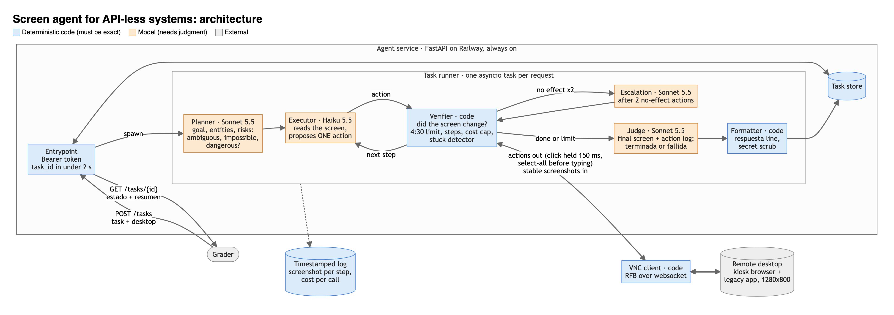

# agente-sin-api

Agente que opera por pantalla (VNC) sistemas de gestión sin API y ejecuta tareas pedidas en
lenguaje natural, incluso en apps que nunca ha visto. Reto 1 de Frontier Bogotá 2026.

> Estado: en construcción.

## Cómo correrlo

Requisitos: Python 3.12 o más reciente y [uv](https://docs.astral.sh/uv/).

```bash
uv sync                      # instala dependencias (incluye las de desarrollo)
cp .env.example .env         # y llena los valores; .env nunca se sube
uv run python -m pytest tests -q
```

Variables de `.env` (ver `.env.example`):

| Variable | Para qué |
|---|---|
| `OPENROUTER_API_KEY` | Llamadas a los modelos |
| `AGENT_MODEL`, `SUPERVISOR_MODEL` | Operador por paso (`anthropic/claude-haiku-5.5`) y supervisor (`anthropic/claude-sonnet-5.5`) |
| `TEAM_TOKEN` | Token que exige el entrypoint en `Authorization: Bearer` |
| `DESKTOP_URL`, `DESKTOP_PASSWORD`, `DESKTOP_TOKEN` | Escritorio de práctica, solo para los harness locales |
| `MEMORY`, `MEMORY_DB` | Memoria que aprende: apagada salvo `MEMORY=on`; base SQLite |

Servicio local y una tarea de prueba:

```bash
uv run uvicorn service.api:app --port 8000
curl -s localhost:8000/health
curl -s -X POST localhost:8000/tasks -H "Authorization: Bearer $TEAM_TOKEN" \
  -H "Content-Type: application/json" \
  -d '{"tarea": "¿Cuántas facturas vencidas hay?", "escritorio": {"url": "wss://…/websockify", "password": "…"}}'
curl -s localhost:8000/tasks/<task_id> -H "Authorization: Bearer $TEAM_TOKEN"
```

Harness de evaluación (resetea el escritorio, corre el agente y pide `__check`):

```bash
uv run python -m evals.run                    # todos los casos de evals/cases/, en proceso
uv run python -m evals.run E1 --reps 3        # un caso, varias veces
uv run python -m evals.targets <URL> E2       # el mismo caso por HTTP contra el entrypoint desplegado
uv run python -m evals.curve --n 4            # curva de aprendizaje: sin memoria y con memoria
uv run python -m evals.canary --cada 20       # canario: avisa si la app cambió
```

Deploy (Railway): el `Dockerfile` construye la imagen y `railway.json` define el chequeo de
`/health`. Se monta un volumen en `/data` para las trazas y la memoria, y se configuran las mismas
variables de `.env` salvo las del escritorio de práctica.

## Contrato del entrypoint

| Ruta | Qué hace |
|---|---|
| `GET /health` | 200 cuando el agente está listo |
| `POST /tasks` | Recibe `{tarea, escritorio: {url, password}}` y responde `{"task_id": "…"}` en menos de 2 s |
| `GET /tasks/{task_id}` | `{"estado": "en_curso" \| "terminada" \| "fallida", "resumen": "…"}` |

Todas las llamadas llevan `Authorization: Bearer <TEAM_TOKEN>`.

## Arquitectura



Principio: **el modelo percibe y decide; el código garantiza.** El agente no tiene DOM ni API: ve
capturas por VNC y actúa con mouse y teclado.

| Pieza | Archivo | Qué hace | Modelo |
|---|---|---|---|
| Servicio | `service/` | Contrato HTTP, una tarea asyncio por pedido, reloj de 270 s, filtro de secretos | Ninguno |
| Comprensión | `agent/comprension.py` | Convierte la instrucción en un `TaskSpec`: tipo, entidad, referente, valores literales, riesgos | Sonnet 5.5 |
| Operador | `agent/operador.py` | Observa, decide y actúa paso a paso con herramientas (clic, rellenar, leer lista, contar, terminar) | Haiku 5.5 |
| Driver | `agent/rfb.py`, `agent/escritorio.py` | Cliente VNC propio: clic sostenido 180 ms (bajo 100 ms la app lo ignora), teclas a 80 ms (tildes), lectura exacta por portapapeles | Ninguno |
| Compuertas | `agent/operador.py` | Toda acción que puede cambiar datos pasa por revisión; se guarda una sola vez | Sonnet 5.5 |
| Verificación | `agent/operador.py` | Contexto limpio: relee la app y decide `terminada` o `fallida` | Sonnet 5.5 |
| Recuperación | `agent/recuperacion.py` | Diario de campos editados, diagnóstico de la falla y restauración del valor anterior exacto | Reglas, y Sonnet solo si son ambiguas |
| Reporte | `agent/reporte.py` | Plantilla, línea `respuesta:` por código, sin secretos | Ninguno |
| Memoria | `agent/memory/` | Huella de la app, recetas verificadas con anclas visuales, lecciones del verificador | Ninguno |

Detalle y alternativas descartadas en [docs/DISENO.md](docs/DISENO.md).

### Memoria que aprende

Aprende solo de tareas que la verificación confirmó (y, en desarrollo, que pasaron `__check`).

- **Huella:** miniatura en color de la primera pantalla y de la barra superior. Tras un reset, la
  pantalla inicial de la misma app es idéntica al píxel; otra página difiere ~25%.
- **Recetas:** de una traza verificada se guarda solo lo que no cambia datos: navegación y campos que
  salen del `TaskSpec`. Se corta antes de cualquier clic que pueda guardar y antes de editar un
  registro existente. Al repetirla, cada clic exige que el recorte de 48×48 px alrededor del punto
  siga en pantalla (±3 px; dos menús vecinos difieren 9,5% y el umbral es 3%). Si no coincide, se
  detiene y el operador sigue desde ahí.
- **Lecciones:** lo que la verificación exigió antes de aceptar una tarea de ese tipo, y los pasos
  donde una receta dejó de coincidir. Van en el prompt del operador.
- Está **apagada en producción** (`MEMORY=on` la enciende) hasta que la curva muestre mejora.

## Evaluación

Harness propio: `__reset` → agente → `__check` de la app + chequeos locales (estado, línea
`respuesta:`, datos clave de la razón, sin secretos). Casos en `evals/cases/` (E1-E5 del enunciado y
J1, una ciudad que no existe en la lista cerrada).

| Hora | Versión | Resultado | Costo total | Tiempo medio |
|---|---|---|---|---|
| 13:04 | línea base | 4/5 | US$0,19 | 85 s |
| 13:15 | `ca6d5f5` (compuerta por nombre del control) | 5/5 | US$0,115 | 55 s |
| 13:38 | `46c27c0` (guarda de borde) | 5/5, y E1 3/3 | US$0,115 | 56 s |

Curva de aprendizaje (13:42, `evals/curve.py`, 4 tareas de crear con datos distintos):

| Modo | Pasan | Llamadas (media) | Costo (media) | Tiempo (media) |
|---|---|---|---|---|
| Sin memoria | 3/4 | 13,5 | US$0,030 | 72 s |
| Con memoria (tareas 2-4) | 2/3 | 13,3 | US$0,041 | 94 s |

La primera versión de la memoria **no mejoró**: la receta dejaba una búsqueda escrita sin ejecutar y
el verificador devolvía la tarea. Además, ~70% del costo es Sonnet (comprensión, revisión y
verificación), que la memoria no salta a propósito. Ver [FALLAS.md](FALLAS.md).

## Incidente

Protocolo preparado antes de las 15:30:

1. **Detectar sin modelo.** `evals/canary.py` resetea el escritorio de práctica cada 5 minutos, llega
   con clics fijos a seis pantallas (inicio, menú, lista y formulario de clientes, facturas, pedidos)
   y compara cada una con su base al píxel. Tras un reset, la misma pantalla da 0 píxeles de
   diferencia y un menú renombrado mueve ~230, así que cualquier cambio dispara la alerta (campana,
   notificación, imágenes con las regiones marcadas y línea con hora en `runs/canary/log.jsonl`).
2. **Medir el impacto.** Correr `evals.run` completo y comparar con la línea base de las 15:00.
3. **Adaptarse.** El agente no depende de coordenadas: percibe cada pantalla. La memoria, si estuviera
   encendida, deja de repetir una receta en cuanto un ancla no coincide.
4. **Explicar.** Esta sección: hora de detección, síntoma, causa, arreglo y evals antes y después.

_Resultado: se llena cuando ocurra._

## Límites conocidos

Ver [FALLAS.md](FALLAS.md).
