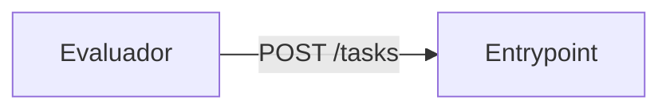

# Diseño: agente que opera lo que no tiene API

_Una página. Cierre: 12:00._

## 1. Problema

## 2. Supuestos

## 3. Casos difíciles

## 4. Fuera de alcance

## 5. Arquitectura

## 6. Decisiones

| Decisión | Alternativa descartada | Por qué |
|---|---|---|

## 7. Plan para medir

## 8. Riesgos y monitoreo (incidente 15:30)
