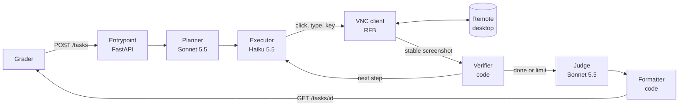

# Screen agent for API-less systems: design

Frontier Bogotá 2026 · Challenge 1 · Team design

## 1. Problem

Turn a natural-language request into **exactly** the right outcome inside a legacy business app the
agent has never seen, using only pixels and mouse/keyboard over VNC, in under 5 minutes. "Right"
means the expected record changes and nothing else: no extra edits, no duplicates, an honest final
state (`fallida` when the task is ambiguous, impossible or dangerous) and a summary the grader can
parse. The hard part is not clicking. It is **generalizing to unknown UIs and knowing when to stop**.

## 2. Assumptions

1. Evaluation apps are reached like the practice app (noVNC, 1280×800, same endpoints) and are typical
   CRUD tools: menus, lists, search/filters, forms, modals, confirmations, exports.
2. The screen is the only source of truth. No DOM, no API, no network from the app.
3. "Today" is the date shown by the app, not the server clock.
4. The hidden set size is unknown, so the cost per task must stay far below the US$5 reserve (target ≤ US$0.10).
5. The UI can change during the day, so nothing about a specific app is hardcoded.

## 3. Hard cases and how we handle them

| Case | Handling |
|---|---|
| Ambiguous entity (two "Ana Torres") | Never modify. Report `fallida` naming the distinguishing data (IDs, documents) |
| Impossible or dangerous request | `fallida` with the reason. Destructive actions outside the request are refused |
| Questions (counts, totals) | Use the app's own filters and totals, then `respuesta: <number first>`; two values joined with `;` |
| Duplicates | Search before creating; never resubmit a form without checking the list first |
| Slow repaint / ignored fast clicks / text concatenation | Code waits for a stable frame, holds each click 150 ms, selects all before typing |
| Running out of time | Hard stop at 4:30, report, and stop touching the desktop |

## 4. Out of scope (and why)

Persistent per-app memory across tasks (stale after a UI change, and a wrong memory is worse than
none) · multi-app workflows · CAPTCHAs · fine-tuning a model (no time to collect data that generalizes).

## 5. Architecture

Code owns everything that must be exact; models own what needs judgment. **Planner** reads the task
and first screen, flags ambiguity and danger. **Executor** proposes one action per screen.
**Verifier** checks that the action changed the screen and enforces limits. **Judge** sees the final
screen and action log and decides `terminada`/`fallida`. **Formatter** guarantees the grader format
and removes secrets. Every step is logged with a timestamp and a screenshot.

## 6. Decisions

| Decision | Rejected alternative | Why |
|---|---|---|
| Vision model reads raw screenshots | OCR + text-only model | OCR loses layout (which label owns which input, icons, checkboxes). OCR stays as an optional hint if misreads dominate failures |
| Haiku 5.5 executes each step (est. 25 steps: ~US$0.06/task incl. judge, ~83 tasks per US$5) | Sonnet 5.5 as executor (~US$0.31/task, ~16 tasks per US$5) | Sonnet is about 20× the price and slower per step, so fewer steps fit in 5 min. A measured bake-off decides |
| Sonnet only where judgment matters (plan, final verdict, escalation) | One cheap model for everything | False success and wrong refusals are the costliest errors; two strong calls per task are cheap insurance |
| Model proposes, code verifies | Trust the model's own report | Grader penalizes false success; screen-diff and limits catch silent failures |
| Direct RFB client over websocket | Headless browser running noVNC | Fewer layers and exact click timing. noVNC stays as fallback |
| Fresh exploration per task | Persistent memory per app | Robust to UI changes; correctness beats speed |
| Railway, always on (Docker) | Laptop + tunnel | The contract requires uptime through demo day |

## 7. How we measure (before building)

- **One command** `uv run python -m evals.run` resets the desktop, sends each case to our entrypoint,
  calls `/__check`, verifies `estado` and summary format, and prints success rate, cost per task,
  latency and failure type.
- **Cases:** the 5 given + ~15 of ours (rephrasings and new tasks per type: create, edit, question,
  export, ambiguous, impossible, destructive, relative dates, two-value answers).
- **Generalization:** a **holdout app** with another domain and layout that the agent never sees during
  tuning, plus a check that fails if practice-app names appear in agent code or prompts.
- **Targets:** ≥ 80% own set, ≥ 60% holdout, 0 destructive actions, ≤ US$0.10 and p95 < 4 min per task.
  The 3 hidden-set runs are milestones: skeleton, after the incident, final.

## 8. Risks and monitoring

| Risk | Detection | Response |
|---|---|---|
| UI changes mid-day (15:30) | "No effect" and "stuck" alarms; eval baseline at 15:00 and rerun | Per-case diff shows what broke; fix and document in README |
| Misclicks by the small model | Repeated no-effect actions | Escalate that step to Sonnet after 2 failures |
| Budget overrun | Cost tracked per call | Per-task cost cap; stop and report |
