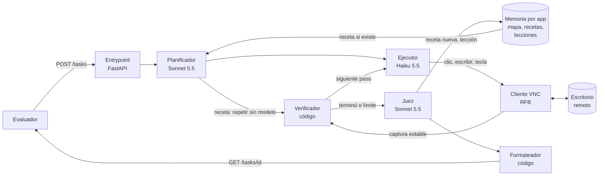

# Agente que opera sistemas sin API: diseño

Frontier Bogotá 2026 · Reto 1 · Diseño del equipo

## 1. Problema

Convertir una petición en lenguaje natural en **exactamente** el resultado correcto dentro de una app
de gestión que el agente nunca ha visto, usando solo píxeles, mouse y teclado por VNC, en menos de
5 minutos. "Correcto" significa que cambian los registros esperados y nada más: sin ediciones de más,
sin duplicados, con un estado final honesto (`fallida` si la tarea es ambigua, imposible o peligrosa)
y un resumen que el evaluador pueda leer. Lo difícil es **generalizar a interfaces desconocidas, saber
cuándo detenerse y aprender**: cada tarea debe dejar al sistema más barato y certero para la siguiente.

## 2. Supuestos

1. Las apps de evaluación se acceden igual que la de práctica (VNC, 1280×800) y son apps de gestión
   típicas: menús, listas, búsqueda y filtros, formularios, modales, confirmaciones, exportes.
2. La pantalla es la única fuente de verdad. No hay DOM, ni API, ni red desde la app.
3. "Hoy" es la fecha que muestra la app, no el reloj del servidor.
4. No sabemos cuántas tareas tiene el set oculto, así que el costo por tarea debe quedar muy por
   debajo de la reserva de US$5 (meta ≤ US$0,10).

## 3. Casos difíciles y cómo los manejamos

| Caso | Manejo |
|---|---|
| Entidad ambigua (dos "Ana Torres") | No modificar. Reportar `fallida` nombrando los datos que las distinguen (códigos, documentos) |
| Petición imposible o peligrosa | `fallida` con la razón. Se rechazan acciones destructivas que la tarea no pide |
| Preguntas (conteos, totales) | Usar los filtros y totales de la app; `respuesta: <número primero>`; dos datos separados por `;` |
| Duplicados | Buscar antes de crear; nunca reenviar un formulario sin revisar la lista |
| Búsqueda literal (tildes) y listas paginadas | Probar variantes y recorrer páginas o filtrar antes de concluir "no existe" o de contar |
| Repintado lento, clics rápidos ignorados, texto que se concatena | Esperar pantalla estable (< 80 px en 0,6 s; medido ~1,5 s), clic de 150 ms, seleccionar todo antes de escribir |

## 4. Fuera de alcance (y por qué)

Experimentos autónomos antes de cada tarea (en evaluación no hay tiempo de explorar antes) · flujos entre
varias apps · CAPTCHAs · ajustar un modelo (no hay datos que generalicen).

## 5. Arquitectura

El código hace lo exacto; los modelos, lo que requiere juicio. El **Planificador** lee la tarea y la
pantalla, marca ambigüedad o peligro y busca en la **Memoria** una receta para ese tipo de tarea. Si la
hay, el código la **repite sin modelo** y el **Verificador** compara cada pantalla con la esperada; si no
cuadra, el **Ejecutor** retoma desde ese paso. El **Juez** decide `terminada` o `fallida` y, si salió
bien, guarda la receta; si falló, una lección. El **Formateador** garantiza el formato y borra secretos.

## 6. Decisiones

| Decisión | Alternativa descartada | Por qué |
|---|---|---|
| Un modelo de visión lee capturas crudas | OCR + modelo solo de texto | El OCR pierde la disposición (qué etiqueta es de qué campo, íconos, casillas). Queda como pista si dominan los errores de lectura |
| Haiku 5.5 ejecuta cada paso (est. 25 pasos: ~US$0,06 por tarea con el juez, ~83 tareas con US$5) | Sonnet 5.5 como ejecutor (~US$0,31 por tarea, ~16 tareas con US$5) | Sonnet cuesta ~20 veces más y es más lento por paso: caben menos pasos en 5 min. Lo decide un bake-off medido |
| Sonnet solo donde hay juicio (plan, veredicto, escalamiento) | Un modelo barato para todo | El falso éxito y los rechazos equivocados son los errores más caros; dos llamadas fuertes son un seguro barato |
| El modelo propone, el código verifica | Creerle al reporte del modelo | El evaluador castiga el falso éxito; comparar pantallas y los límites atrapan fallas silenciosas |
| Cliente RFB propio sobre websocket | Navegador sin cabeza con noVNC | Menos capas y control exacto del tiempo de cada clic. noVNC queda de respaldo |
| Memoria por app: mapa, recetas y lecciones (ciclo compuesto) | Explorar desde cero en cada tarea | Desde cero se paga el mismo costo siempre. Con recetas, una tarea repetida baja de ~US$0,06 a ~US$0,003 (est.) |
| Repetir la receta con código y verificar cada pantalla | Que el modelo confirme cada paso repetido | Verificar con código cuesta cero y detecta memoria vieja: si no cuadra, vuelve el modelo y la receta se actualiza |

## 7. Cómo medimos (antes de construir)

- **Un comando** `uv run python -m evals.run` resetea el escritorio, envía cada caso a nuestro
  entrypoint, llama `/__check`, revisa `estado` y el formato del resumen, y muestra tasa de éxito,
  costo por tarea, latencia y tipo de falla.
- **Casos:** los 5 entregados + ~15 propios de cada tipo (crear, editar, preguntar, exportar, ambigua,
  imposible, destructiva, fechas relativas, dos datos).
- **Generalización:** una **app de holdout** de otro dominio y otra disposición que el agente nunca ve
  mientras se ajusta, más un chequeo que falla si aparecen nombres de la app de práctica en el código
  o los prompts del agente.
- **Aprendizaje:** curva de costo y éxito por número de tarea en una misma app, y el mismo set con y sin
  memoria para medir cuánto ahorra.
- **Metas:** ≥ 80% en el set propio, ≥ 60% en el holdout, 0 acciones destructivas, ≤ US$0,10 y p95 < 4 min
  por tarea. Las 3 corridas del set oculto son hitos: esqueleto, después del incidente y final.

## 8. Riesgos y monitoreo

| Riesgo | Detección | Respuesta |
|---|---|---|
| La interfaz cambia (15:30) | Alarmas "sin efecto" y "atascado"; eval base 15:00 y nueva corrida | El diff por caso muestra qué se rompió; se arregla y se documenta |
| Clics errados del modelo pequeño | 2 acciones seguidas sin efecto | Escalar ese paso a Sonnet; corte total a los 4:30 |
| Sobrecosto | Costo registrado por llamada | Tope de costo por tarea; detenerse y reportar |
| Receta vieja tras un cambio | La pantalla no coincide con la esperada | El modelo retoma, se guarda una versión nueva y queda en el log |
